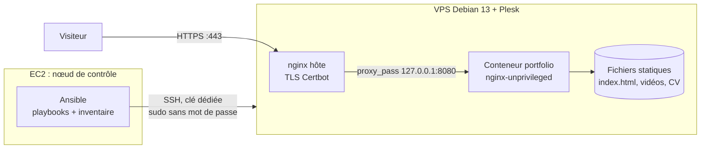

# portfolio : enrique-pierret.com


Site personnel, servi par un conteneur Docker derrière nginx (reverse proxy avec TLS), déployé par Ansible.

## Architecture



- **EC2** : exécute Ansible. C'est depuis là que le site est déployé et audité.
- **nginx sur l'hôte** : termine le TLS (Certbot) et redirige HTTP vers HTTPS.
- **Conteneur** : sert les fichiers statiques sur un port non privilégié, lié à `127.0.0.1`.

## Structure du dépôt

| Fichier | Rôle |
|---|---|
| `Dockerfile` | Image basée sur `nginxinc/nginx-unprivileged:1.27-alpine` |
| `site/` | Contenu du site, copié dans l'image |
| `ansible/audit.yml` | État des lieux du VPS, lecture seule |
| `ansible/deploy.yml` | Déploiement : copie, build de l'image, relance du conteneur, vérification |
| `ansible/inventory.ini` | Cible : le VPS, avec un compte dédié `ansible` |
| `.dockerignore` | Exclut sauvegardes, `.git` et `.env` du contexte de build |

## Automatisation (Ansible)

Prérequis sur l'EC2 : Ansible installé, une clé SSH dédiée au VPS, et le compte `ansible` sur le VPS avec `sudo` sans mot de passe. La connexion par mot de passe est désactivée et root est restreint à la clé.

Audit (lecture seule, ne modifie rien) :

```bash
cd ansible
ansible-playbook -i inventory.ini audit.yml
```

Déploiement (copie les fichiers, reconstruit l'image, relance le conteneur et vérifie la réponse en 200) :

```bash
git pull
cd ansible
ansible-playbook -i inventory.ini deploy.yml
```

Le déploiement remplace le conteneur : il y a une coupure de quelques secondes.

## Build et lancement manuels

```bash
docker build -t portfolio:test .

docker run -d --name portfolio --restart unless-stopped \
  -p 127.0.0.1:8080:8080 \
  --read-only --tmpfs /tmp --tmpfs /var/cache/nginx \
  --security-opt no-new-privileges:true \
  portfolio:test
```

Vérification :

```bash
curl -sI http://127.0.0.1:8080 | head -n 1   # HTTP/1.1 200 OK
```

## Choix de sécurité

| Mesure | Effet |
|---|---|
| Image `unprivileged` | nginx tourne sans root |
| `--read-only` | système de fichiers en lecture seule |
| `--tmpfs /tmp`, `/var/cache/nginx` | seuls dossiers inscriptibles, en mémoire |
| `no-new-privileges` | le processus ne peut pas gagner de privilèges |
| `-p 127.0.0.1:...` | port accessible uniquement depuis la machine hôte |
| Connexion SSH par clé | mot de passe désactivé, root restreint |
| Compte `ansible` dédié | accès d'automatisation séparé des comptes humains |

## Configuration nginx (proxy)

Dans le bloc `server` du domaine, le trafic est transmis au conteneur :

```nginx
location / {
    proxy_pass http://127.0.0.1:8080;
    proxy_set_header Host $host;
    proxy_set_header X-Forwarded-Proto $scheme;
    proxy_set_header X-Real-IP $remote_addr;
}
```

Les lignes `listen 443 ssl` et `ssl_certificate` restent celles gérées par Certbot. Cette configuration n'est pas encore automatisée : Plesk gère nginx sur le VPS.

## Limites et prochaines étapes

- L'infrastructure du VPS (serveur, IP, pare-feu) est gérée à la main depuis le panneau IONOS. L'import dans OpenTofu n'est pas fait, faute de ressource fournisseur adaptée à l'offre VPS.
- nginx n'est pas encore automatisé, car Plesk réécrit sa configuration.
- Pas encore de pipeline CI.
- Les certificats sont renouvelés par Certbot ; la configuration TLS n'est pas dans ce dépôt.
