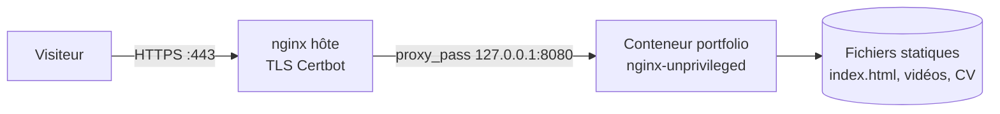

# portfolio : enrique-pierret.com


Site personnel, servi par un conteneur Docker derrière nginx (reverse proxy avec TLS).

## Architecture



- **nginx sur l'hôte** : termine le TLS (certificat Let's Encrypt géré par Certbot) et redirige HTTP vers HTTPS.
- **Conteneur** : sert uniquement les fichiers statiques, sur un port non privilégié, lié à `127.0.0.1` : il n'est pas exposé directement sur Internet.

## Structure du dépôt

| Fichier | Rôle |
|---|---|
| `Dockerfile` | Image basée sur `nginxinc/nginx-unprivileged:1.27-alpine` |
| `site/` | Contenu du site, copié dans l'image |
| `.dockerignore` | Exclut sauvegardes, `.git` et `.env` du contexte de build |
| `.gitignore` | Exclut `.env` et les sauvegardes |

## Build et lancement

```bash
docker build -t portfolio:test .

docker run -d --name portfolio --restart unless-stopped \
  -p 127.0.0.1:8080:8080 \
  --read-only --tmpfs /tmp --tmpfs /var/cache/nginx \
  --security-opt no-new-privileges:true \
  portfolio:test
```

Vérification :

```bash
curl -sI http://127.0.0.1:8080 | head -n 1   # HTTP/1.1 200 OK
```

## Choix de sécurité du conteneur

| Option | Effet |
|---|---|
| Image `unprivileged` | nginx tourne sans root |
| `--read-only` | système de fichiers en lecture seule |
| `--tmpfs /tmp`, `/var/cache/nginx` | seuls dossiers inscriptibles, en mémoire |
| `no-new-privileges` | le processus ne peut pas gagner de privilèges |
| `-p 127.0.0.1:...` | port accessible uniquement depuis la machine hôte |

## Configuration nginx (proxy)

Dans le bloc `server` du domaine, le trafic est transmis au conteneur :

```nginx
location / {
    proxy_pass http://127.0.0.1:8080;
    proxy_set_header Host $host;
    proxy_set_header X-Forwarded-Proto $scheme;
    proxy_set_header X-Real-IP $remote_addr;
}
```

Les lignes `listen 443 ssl` et `ssl_certificate` restent celles gérées par Certbot.

Test de la configuration puis rechargement :

```bash
sudo nginx -t && sudo systemctl reload nginx
```

## Mise à jour du site

1. Modifier les fichiers dans `site/`.
2. Reconstruire l'image et relancer le conteneur (commandes ci-dessus).
3. Vérifier avec `curl -sI https://enrique-pierret.com`.

## Limites et prochaines étapes

- Le déploiement est manuel. Prochaine étape : automatiser avec Ansible et provisionner la VM avec OpenTofu.
- Pas encore de pipeline CI.
- Les certificats sont renouvelés par Certbot, la configuration TLS n'est pas dans ce dépôt.
